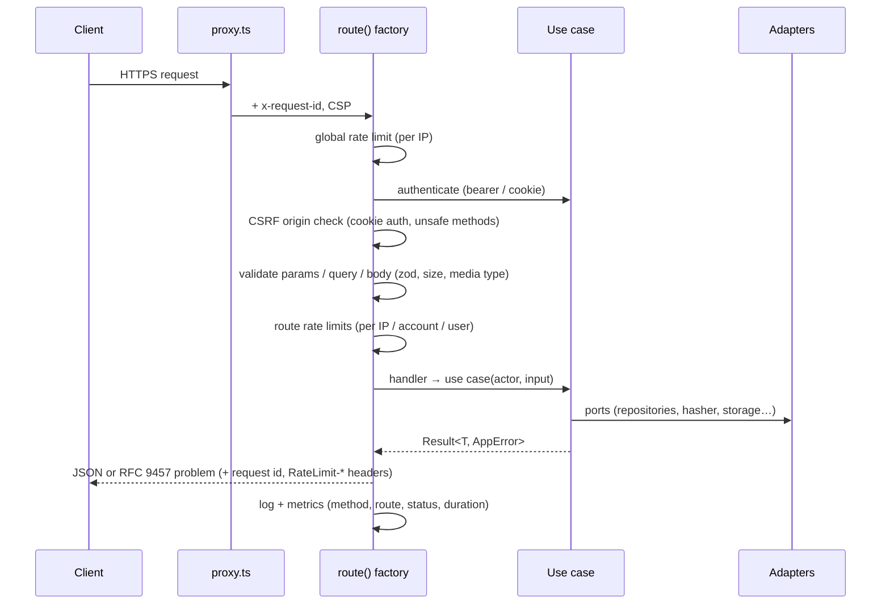

# Architecture

## Principles

1. **Domain first (DDD).** Business rules live in aggregates and value objects (`User`, `Session`, `StoredFile`, `Email`, `PlainPassword`…). They have no knowledge of HTTP, SQL, Redis or S3.
2. **Ports & adapters (hexagonal).** Use cases depend on interfaces (`UserRepository`, `PasswordHasher`, `RateLimiter`, `ObjectStorage`…). Concrete adapters live in `infrastructure/` and are wired only in `src/composition/container.ts`.
3. **Dependencies point inward.** `interface → application → domain`, `infrastructure → application/domain`. Enforced by `no-restricted-imports` rules in `eslint.config.mjs`; CI fails on violations.
4. **Type safety end-to-end.** `strict`, `noUncheckedIndexedAccess`, `exactOptionalPropertyTypes`; branded ids (`UserId` ≠ `SessionId`); zod schemas infer handler input types; `Result<T, AppError>` makes expected failures explicit.
5. **Expected vs unexpected failures.** Business outcomes (`email taken`, `weak password`) are returned as `Result` errors. Infrastructure failures throw. Both are translated in exactly one place — the HTTP error boundary.

## Bounded contexts

| Context       | Aggregates        | Responsibilities                                                    |
| ------------- | ----------------- | ------------------------------------------------------------------- |
| `identity`    | `User`, `Session` | registration, login, lockout, sessions, profile, RBAC, audit events |
| `storage`     | `StoredFile`      | upload policy, presigned upload/download, ownership checks          |
| shared kernel | —                 | permission catalogue & role policy, ids, errors, `Result`           |

Contexts communicate through the shared kernel's `Actor` (who is calling, with which permissions) rather than importing each other's internals.

## Request lifecycle

Every endpoint is declared with `route({...})` (`src/shared/interface/http/route.ts`), so cross-cutting behaviour cannot be forgotten on a new endpoint.

## Error handling (error boundaries)

| Layer                | Mechanism                                                                                                         |
| -------------------- | ----------------------------------------------------------------------------------------------------------------- |
| Domain / application | `Result<T, AppError>` with stable codes (`identity.email_taken`)                                                  |
| HTTP                 | `toProblem()` maps `AppError.kind` → status; unknown errors → generic 500 + request id; stack traces only in logs |
| Next.js server       | `instrumentation.ts#onRequestError` logs any error escaping a handler/render                                      |
| React UI             | `app/error.tsx` (segment) and `app/global-error.tsx` (root layout)                                                |
| Broken configuration | env validated with zod at first use; `/api/health/ready` → 503; fallback stderr logging                           |

## Adding a feature (checklist)

1. **Domain:** add/extend an aggregate or value object; write unit tests in `tests/unit/<module>/`.
2. **Application:** add a use case class taking `Pick<Deps, …>`; check permissions with `requirePermission(actor, '…')`; return `Result`.
3. **Port/adapter:** if new I/O is needed, define the interface in `application/ports`, implement it in `infrastructure/`, add an in-memory fake in `tests/support/fakes.ts`, and an integration test.
4. **Schema change:** edit `db/schema.ts`, run `pnpm db:generate`, review the SQL, commit it.
5. **Composition:** wire it in `composition/container.ts`.
6. **HTTP:** add a strict zod schema + handler in `modules/<m>/interface/http`, then a one-line `src/app/api/v1/.../route.ts` re-export.
7. **Permissions:** new capabilities go into `PERMISSIONS` / `ROLE_PERMISSIONS` in `shared/domain/permissions.ts`.
8. `pnpm verify` and update `docs/api.md`.

## Why Next.js for an API?

Native Vercel target (zero-config deploys and previews) while `output: 'standalone'` produces a portable Node server for containers. Framework code is confined to `src/app`, `proxy.ts` and `instrumentation.ts`; moving to Fastify/Hono later means rewriting only the thin delivery layer — see [ADR 0001](adr/0001-nextjs-route-handlers-as-delivery.md).
